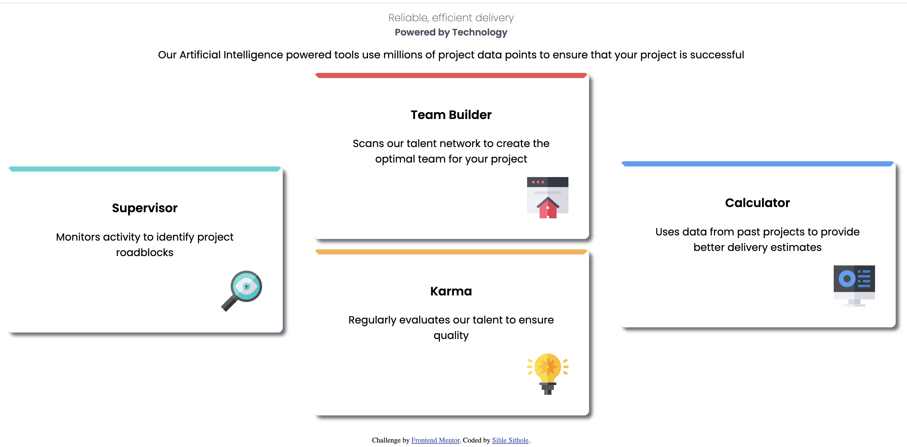

## Table of contents

- [Overview](#overview)
  - [The challenge](#the-challenge)
  - [Screenshot](#screenshot)
  - [Links](#links)
- [My process](#my-process)
  - [Built with](#built-with)
  - [What I learned](#what-i-learned)
  - [Continued development](#continued-development)
  - [Useful resources](#useful-resources)

## Overview

### The challenge

Users should be able to:

- View the optimal layout for the site depending on their device's screen size

### Screenshot

### Links

- Solution URL: [Add solution URL here](https://github.com/Sihle97/four-card-feature-section)
- Live Site URL: [Add live site URL here](https://sihle97.github.io/four-card-feature-selection)

## My process

### Built with

- Semantic HTML5 markup
- CSS custom properties
- CSS Grid

### What I learned

Display Grid concept generally and how it apply that code to the design that was set out.

### Continued development

More Display Grid implementation with more complicated designs to solidify the knowledge

### Useful resources

- [CSS Tricks Grid Layout](https://css-tricks.com/complete-guide-css-grid-layout/) - Everything and anything CSS Grid Layout related
